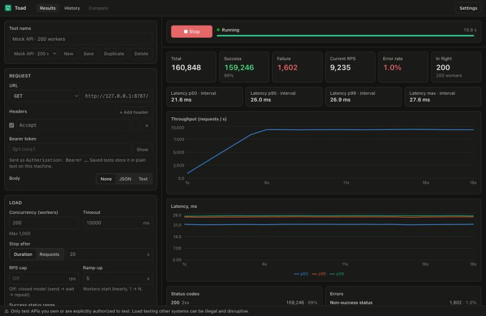

# Toad

A small, fast desktop app for load-testing HTTP APIs. Configure a request, set the
load, press Start, and watch throughput, latency percentiles and errors update live.

> **Only test APIs you own or are explicitly authorized to test.** Load testing
> systems without permission can be illegal and can take down services other people
> depend on. Toad asks for confirmation before sending traffic to anything that is
> not a loopback address.



## Layout

```
Cargo.toml                 workspace
crates/toad-core/          engine, limiter, metrics, models, export, safety (no Tauri)
  examples/mock_server.rs  configurable axum mock API
  tests/engine_it.rs       engine ↔ mock-server integration tests
src-tauri/                 thin Tauri app: commands, events, storage, state
  capabilities/default.json
src/                       React + TypeScript UI
  bindings.ts              GENERATED from Rust by tauri-specta (do not edit)
  lib/api.ts               typed wrappers + event listeners
```

## Setup

Requirements: Rust 1.85+, Node 20+, pnpm 10+, and the
[Tauri 2 system prerequisites](https://v2.tauri.app/start/prerequisites/) for your OS
(Xcode command-line tools on macOS; WebView2 + MSVC build tools on Windows;
`webkit2gtk-4.1`, `libayatana-appindicator3` etc. on Linux).

```bash
pnpm install
pnpm tauri dev          # run the app in development
pnpm tauri build        # release bundle for the host OS (src-tauri/../target/release/bundle)
```

Try it against the bundled mock server:

```bash
cargo run --release --example mock_server -- --port 8787 --delay-ms 20 --jitter-ms 5 --error-rate 0.01
```

Mock flags: `--port`, `--delay-ms`, `--jitter-ms`, `--error-rate` (0–1), `--body-bytes`,
`--seed`. Routes: any path → 200 (or 500 at the error rate), `/status/{code}`,
`/redirect/{n}`.

## Checks

```bash
cargo clippy --workspace --all-targets -- -D warnings
cargo test --workspace
pnpm typecheck && pnpm test
# Perf acceptance (release, local mock): ≥ 5k RPS with 200 workers
cargo test --release -p toad-core --test engine_it -- --ignored --nocapture
```

Headless runs (loopback targets only) for smoke tests or CI:
`cargo run --release -p toad-core --example headless_run -- config.json [--snapshots s.json] [--summary r.json]`.

UI development without the Rust backend: `pnpm dev`, then open
`http://localhost:1420/replay.html`. It mocks Tauri IPC and replays a recorded engine
run from `src/dev/fixtures/`. This page is not part of the production bundle.

`cargo test` also fails if `src/bindings.ts` is out of date. Regenerate with
`TOAD_WRITE_BINDINGS=1 cargo test -p toad bindings` (debug builds of the app also
rewrite it on startup).

## How it measures

**Load model.** By default Toad uses a *closed model*: N workers each send a request,
wait for the full response, and repeat. With an **RPS cap**, a shared lock-free
scheduler hands every request a ticket with an *intended send time* (a GCRA /
token bucket of size 1). Latency is then measured **from the scheduled time**, which
corrects for coordinated omission: if the server stalls, the backlog shows up in the
numbers instead of silently disappearing. Raw *service time* (actual send → last
byte) is recorded alongside. Concurrency still caps in-flight requests, so a target
that needs more workers than you configured produces a "concurrency too low" hint.

- **Headline latency** is corrected latency when capped. Uncapped, the two are
  identical, so a single "Latency" is shown.
- **Latency** is send start → full body read. The body is always drained so
  connections return to the pool. TTFB is recorded too. Transport errors (timeouts,
  connect/DNS/TLS failures) are counted but not added to latency histograms;
  responses with a non-success status are.
- **Ramp-up** is linear over T seconds: workers start one by one from 1 to N
  (uncapped), or the rate rises from 1 rps to the cap (capped). A request-count stop
  includes ramp-up requests.
- **Stop** (button, ⌘/Ctrl+., or Esc when no input or dialog has focus) halts
  scheduling, waits up to 2 s for in-flight requests, then aborts the rest. Aborted
  requests are counted as *cancelled*, not errors, and partial results are kept. A
  duration or request-count run ends the same way.
- **Errors** are classified as timeout, connect, DNS, TLS, body read, redirect
  (more than 5 hops, or to an unconfirmed host), non-success status (broken down by
  code), or other. Success is a configurable status range (default 200–399).
- **Metrics.** Workers record into lock-striped shards (HDR histograms in µs with 3
  significant figures, plus counters). There are 4 shards per CPU core, so the lock
  is effectively private to a worker. Shards are striped rather than one per worker
  because three 1-hour-range histograms per worker would cost hundreds of MB at
  1000 workers. An aggregator drains the shards every 250 ms, merges them into
  interval, per-second and cumulative views, and emits one `run://snapshot` event
  (about 1 KB). The per-second series is saved with the run.
- **Bottleneck warning.** Shown when achieved RPS stays under 90% of target for 3 s
  while service time stays flat and concurrency would suffice. It is also shown when
  the OS runs out of file descriptors, or when Toad's own scheduler lags by more
  than 50 ms.

## OS limits

Each in-flight request holds a socket. Toad raises its soft open-file limit to the
hard limit at startup on macOS and Linux. If you still see the "out of file
descriptors" banner:

- **macOS:** `ulimit -n 65536` in the shell that launches Toad, or
  `sudo launchctl limit maxfiles 65536 200000` system-wide.
- **Linux:** raise `nofile` in `/etc/security/limits.conf` or your systemd unit.
  For very high rates, also widen `net.ipv4.ip_local_port_range` and enable
  `net.ipv4.tcp_tw_reuse`.
- **Windows:** there is no per-process descriptor limit to raise. Ephemeral ports
  can run out at high connection churn (`netsh int ipv4 set dynamicport tcp ...`).

Keep-alive is on and the pool is sized to the concurrency, so connections are reused
and churn is low unless the server closes connections. With `https://` targets that
negotiate HTTP/2, all workers multiplex over a few connections. That is expected.

## Safety and privacy

- Before every run the target is resolved and checked. Anything that isn't loopback
  (`localhost`, `127.0.0.0/8`, `::1`) needs a confirmation, which is remembered per
  host until you quit. Private ranges (10/8, 172.16/12, 192.168/16, IPv6 ULA) also
  need confirmation unless **Settings → Treat private networks as local** is on. The
  backend repeats the check, and the run is pinned to the addresses that were
  checked, so DNS rebinding can't redirect it. Redirects to other hosts are only
  followed if those hosts are loopback or already confirmed.
- Hard ceilings: concurrency defaults to 1000 and RPS to 20,000. You can change both
  in Settings.
- **Secrets are stored in plain text.** Saved tests live as JSON in the app data
  folder, and Toad does not use the OS keychain. In the UI, bearer tokens and
  `Authorization`, `Proxy-Authorization`, `Cookie` and `X-API-Key` values are masked.
  By default they are written to run history as `[redacted]` and stripped from
  exports. Both behaviors can be changed in Settings.
- The webview has no direct filesystem access. Exports are written by Rust, and only
  to a path you picked in the save dialog.

Data location (`dev.toad.desktop`): `~/Library/Application Support/dev.toad.desktop`
(macOS), `%APPDATA%\dev.toad.desktop` (Windows), `~/.local/share/dev.toad.desktop`
(Linux). The folder contains `tests/*.json`, `runs/*.json` (+ `runs/index.json`
cache) and `settings.json`. Toad keeps the last 100 runs by default.

## Keyboard

| Shortcut | Action |
|---|---|
| ⌘/Ctrl + Enter | Start |
| ⌘/Ctrl + . | Stop |
| Esc | Stop, when no input or dialog has focus |

## Non-goals (v1)

Cloud sync, accounts, distributed load, a scripting DSL, auth flows beyond static
headers and bearer tokens, keychain storage, code signing and notarization,
auto-update, HTTP/3, WebSocket and gRPC.
